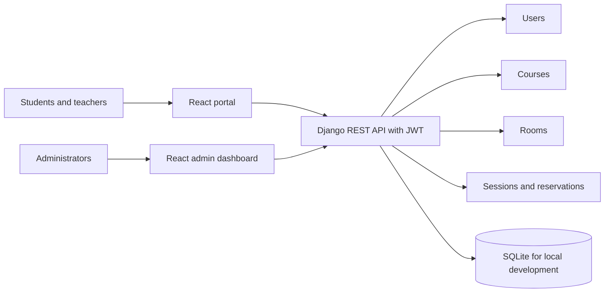

# Student Organization Platform

A Django REST API with two React applications: a student/teacher portal and an administration dashboard.



## Architecture

- `backend/` contains the Django project and the users, courses, rooms, class sessions, and reservations apps.
- The API is rooted at `/api/`. JWT access tokens authenticate protected endpoints.
- Public registration creates student accounts only. Staff users manage accounts, courses, and rooms; teachers manage their own sessions and attendance.
- `frontend/project/` is the student and teacher portal.
- `frontend/admin/` is the administration dashboard.
- SQLite is configured for local development. The database file is excluded from source control.

## Backend Setup

From the repository root, create and activate a virtual environment, then install dependencies:

```powershell
cd backend
py -m venv .venv
.\.venv\Scripts\Activate.ps1
python -m pip install -r requirements.txt
Copy-Item .env.example .env
```

Set a unique `SECRET_KEY` in `backend/.env`. Keep `.env` private. Then initialize the local database and start Django:

```powershell
python manage.py migrate
python manage.py createsuperuser
python manage.py runserver
```

To load fictional demo users, a course, a room, and a session, run:

```powershell
python manage.py seed_demo
```

The demo accounts use `Demo@12345`; use them only with local demo data. The seeded usernames are `demo.student`, `demo.teacher`, and `demo.admin` (`demo.admin@example.com`). The admin dashboard accepts either `demo.admin` or `demo.admin@example.com` as the login identifier.

## Frontend Setup

In each of `frontend/project/` and `frontend/admin/`, copy `.env.example` to `.env.local`, install dependencies, and start or build the app:

```powershell
npm ci
npm start
```

Set `REACT_APP_API_URL` to the API base URL, for example `http://localhost:8000/api`. The frontend development proxy forwards `/api` requests to Django when this value is left unset.

Build either app with `npm run build` from its directory. GitHub Actions runs the Django test suite and builds both React apps for pushes and pull requests.

## Environment Variables

The backend reads `SECRET_KEY`, `DEBUG`, `ALLOWED_HOSTS`, and `CORS_ALLOWED_ORIGINS` from its `.env` file or process environment. `DEBUG` defaults to `False`; provide explicit allowed hosts and frontend origins for deployment. The frontend reads `REACT_APP_API_URL` at build time.

## Known Limitations

- SQLite is suitable for local demos, not a concurrent production deployment. Configure a managed database before production.
- Demo accounts and their shared password are public by design; never seed demo data into a public deployment.
- Rate limits use Django REST Framework's default cache. Configure a shared cache for multi-worker deployments.
- There is no email verification, password recovery, or automated production deployment in this repository.
- Production deployments must provide HTTPS, a strong secret, restrictive CORS origins, and deployment-specific host settings.